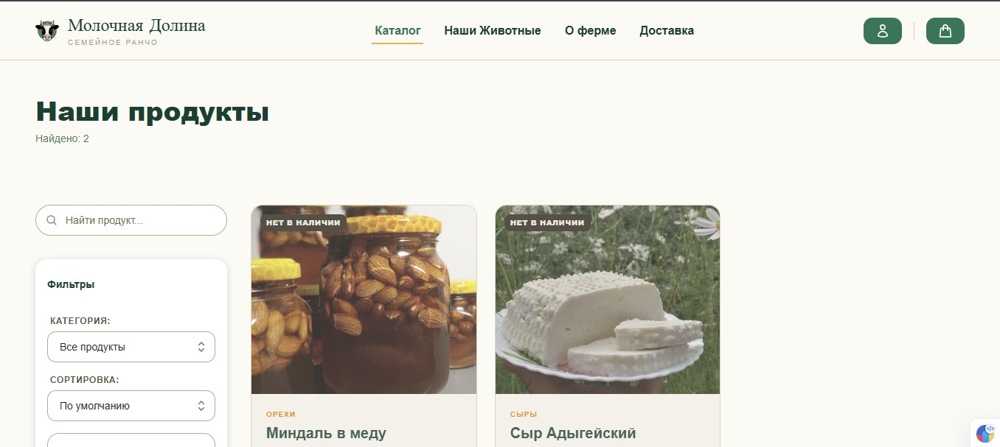
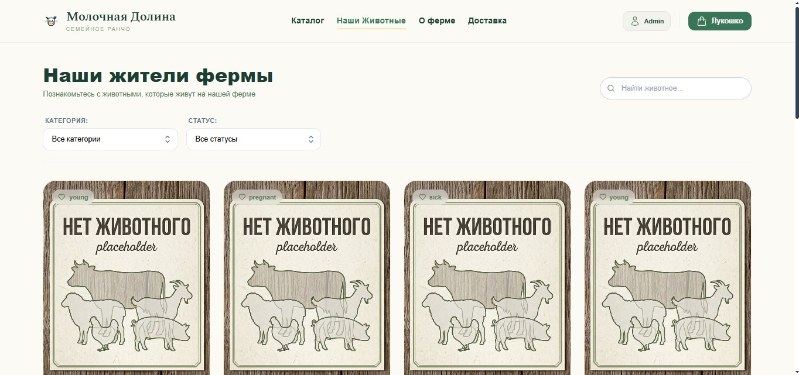
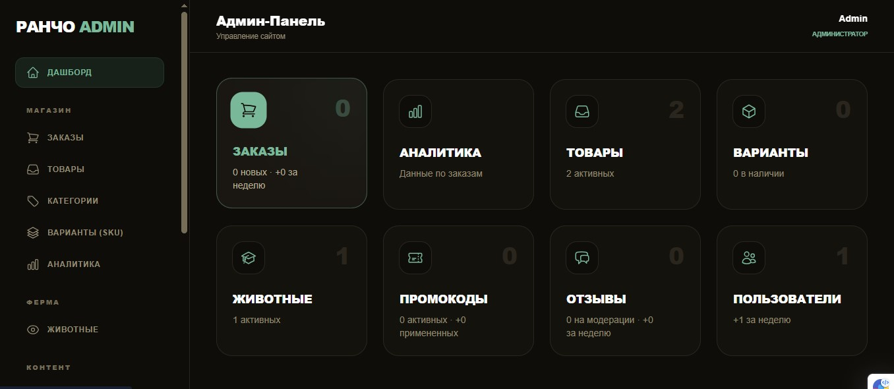
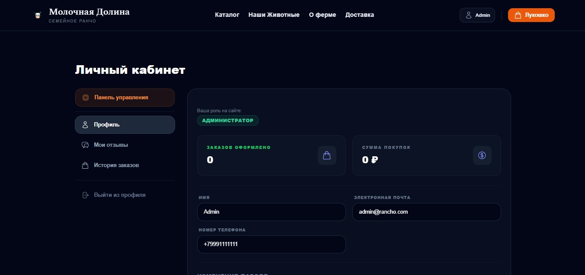

# 🐄 Rancho — Online Store for a Dairy Farm

**🌐 English** · [Русский](README.ru.md)

A pet project — an online store for a small dairy farm: products are linked to specific cows, delivery zones, multi-role admin panel.
Stack: **Laravel 13 + Vue 3 + Inertia.js**. Production: [milkvalley.org](https://milkvalley.org).

---

## 📸 Demo


| Home                                      | Catalog                                       | Animals                                         |
| ----------------------------------------- | --------------------------------------------- | ----------------------------------------------- |
|  |  |  |

| Admin panel                                 | User profile                              |
| ------------------------------------------- | ----------------------------------------- |
|  |  |

> Live production: [https://milkvalley.org](https://milkvalley.org). Runs locally in a couple of minutes (see [Installation](#-installation)).

---

## 🛠 Tech Stack

**Backend**

- PHP 8.3, Laravel 13
- PostgreSQL + **PostGIS** (delivery zones)
- Laravel Sanctum (API auth for the mobile client)
- Laravel Socialite (VK / Google login)
- Spatie Laravel Media Library (`thumb`/`preview` conversions + `webp`/`avif`)
- HTMLPurifier (rich-text sanitizing)
- Tightenco Ziggy (routes in JS)
- Inertia SSR (server-side rendering)

**Architecture**

- Controllers · Services · **Actions · DTO · Enums · Exceptions · Helpers**
- Observers · Policies · Providers · **API Resources**
- Roles: `admin`, `moderator`, `worker`, `customer`
- Soft deletes for cows, products, reviews, pages

**Frontend**

- Vue 3 (Composition API) + TypeScript
- Inertia.js 2
- Vite 8
- Tailwind CSS + Typography plugin
- **Pinia** + persist (cart and settings in localStorage)
- **TipTap** — rich-text editor in the admin panel
- **ApexCharts** (`vue3-apexcharts`) — admin analytics
- **Mapbox GL + Turf.js** — delivery zone map and geo calculations
- **v-calendar** + date-fns — date picker
- Swiper · Howler · VueUse · vuedraggable
- Headless UI · Heroicons · Lucide · Popper
- browser-image-compression — client-side image compression
- Lodash, lodash.debounce

**Integrations**

- **Telegram bot** — notifications about new users and orders to a group chat, with a Yandex map screenshot
- **Yandex Metrica** — counter via `YANDEX_METRIKA_ID`
- **Yandex Static API** — map screenshot for the Telegram bot
- **Payments:** YooKassa (tested), Direct / Tinkoff / PayMaster / Fake via a unified `PaymentGatewayInterface`

**Quality**

- PHPUnit 12 (Unit + Feature)
- Laravel Pint (PSR-12)
- Laravel Pail (dev logs)
- Vitest + @vue/test-utils + jsdom
- ESLint 9 (Vue + TS) + Prettier (Tailwind and import sorting)
- barryvdh/laravel-ide-helper

---

## ✨ Features

### Storefront

- Landing page with configurable blocks (hero, banners, FAQ, featured products)
- Product catalog with filters and pagination
- Product page linked to a specific cow (or general, without a cow)
- "Animals" section — each cow has a profile, bio, audio, gallery, pedigree
- Cart in Pinia (localStorage), prices re-validated against the server
- Checkout with promo codes and discounts
- Reviews (planned: VK / Google login)
- Static pages from the DB (About, Contacts, Terms, 404)
- Contacts page with a Mapbox map

### Delivery

- Delivery zones stored as PostGIS polygons
- Outside the zone → no delivery; near the zone → surcharge
- Address selection with Mapbox + distance check via Turf.js
- **Smart route-based delivery**: admin draws a delivery route, customer picks a point within a radius around it

### Admin Panel

- Products, cows, categories, orders, reviews, pages, settings
- Multi-role access: `admin`, `moderator`, `worker`
- TipTap editor for content
- Dashboard with ApexCharts
- Image galleries with drag & drop upload (Spatie Media Library)
- **Units of measure with `low_stock_threshold`** — visual warning in the admin panel when a product runs low

### SEO

- Morphological SEO table with manual input per model
- Auto-generated OG / Twitter meta
- `robots.txt` editable from the admin panel
- `sitemap.xml` — with priorities and `is_noindex` filtering
- Canonical URLs
- Full ARIA coverage (roles, `aria-label`, `aria-live`, `aria-busy`, …)

### Integrations

- **Telegram bot** — new users and orders to a group (with a Yandex map screenshot)
- **Yandex Metrica** — site counter
- Laravel Socialite (VK / Google) — in progress
- API for the Android client (Sanctum) — partially implemented
- **Payments:** YooKassa (tested), Direct / Tinkoff / PayMaster / Fake via `PaymentGatewayInterface`

### Performance

- **SSR (Inertia server-side rendering)** — fast first paint, better for SEO
- **Modern image formats** — AVIF/WebP via `<picture>`, blur-up, responsive images (Spatie Media Library)

---

## ✅ Implemented

- [x] Clean architecture: Controllers, Services, Actions, DTO, Enums, Exceptions, Helpers, Observers, Policies, Providers, Resources
- [x] Roles: `admin`, `customer`, `moderator`, `worker`
- [x] UI cart with server-side validation via API
- [x] Smart delivery: admin draws a route, customer picks a point within a radius around it
- [x] Smart product variants with creatable units of measure and quantity step
- [x] Units of measure with `low_stock_threshold` — admin warning when a product runs low
- [x] Smart SEO: morphological table, manual input, `robots.txt` from the admin panel, `sitemap.xml`
- [x] Soft deletes: cows, products, reviews, pages
- [x] Role-based access system
- [x] **Telegram bot**: group notifications about new users and orders, with a Yandex map screenshot
- [x] **Yandex Metrica** (counter via `YANDEX_METRIKA_ID`)
- [x] **Yandex Static API** (map screenshot for the Telegram bot)
- [x] Settings with caching (TTL 24 hours, reset on save)
- [x] Discounts and promo codes (DB and admin panel only)
- [x] Payments: YooKassa (tested), Direct, Tinkoff, Fake — via a unified `PaymentGatewayInterface`
- [x] **SSR (server-side rendering in Inertia)**
- [x] **Modern image formats**: AVIF/WebP, `thumb`/`preview` conversions, responsive images
- [x] Magic link, temporary automatic account
- [x] "Share" button

## 🔮 Roadmap

- [ ] English translation.
- [ ] Animal subscriptions.
- [ ] Gifts/points from animals.
- [ ] Animal and product ratings.
- [ ] Cart in the DB?
- [ ] Link "Buy" / "Pre-order" buttons to the delivery schedule.
- [ ] WebSockets. Messages to admin/moderator/worker.

---

## 🚀 Installation

### Requirements

- PHP 8.3+, Composer 2
- Node.js 20+, npm
- PostgreSQL 16+ **with the PostGIS extension**
- **RAM:** at least 2 GB + **4–6 GB swap** for `npm run build` (building 4785 modules on 0.9 GB RAM fails with `Killed`/exit 137). Swap is mandatory on a production server with 1 GB RAM.
- (Optional) Mapbox access token — for the delivery zone map
- (Optional) Yandex Geocoder key — for address suggestions
- (Optional) VK / Google OAuth keys
- (Optional) Telegram bot token + chat_id — for notifications
- (Optional) Yandex Static API key — for the map screenshot in Telegram
- (Optional) Mailtrap or `MAIL_MAILER=log` for local emails

### Setup

```bash
# 1. Clone and install dependencies
git clone https://github.com/Alexey96may/Rancho-Shop.git
cd Rancho-Shop

composer install
npm install

cp .env.example .env
php artisan key:generate

# 2. Edit .env (see "Environment Variables")

# 3. Enable PostGIS in the database
psql -U postgres -d rancho_db -c "CREATE EXTENSION IF NOT EXISTS postgis;"

# 4. Migrations and seeds
php artisan migrate --seed

# 5. Run everything with one command
composer dev
```

`composer dev` starts `php artisan serve`, `npm run dev`, the queue worker, and pail (logs).

### Demo Access

Created by `UserSeeder` (skipped in production). Default passwords:

| Role          | Phone                | Password    |
| ------------- | -------------------- | ----------- |
| **Admin**     | `+7 (999) 111-11-11` | `admin`     |
| **Moderator** | `+7 (999) 333-33-33` | `moderator` |
| **Worker**    | `+7 (999) 444-44-44` | `worker`    |
| **Customer**  | `+7 (999) 222-22-22` | `customer`  |

The admin can be overridden via `.env`: `ADMIN_EMAIL`, `ADMIN_PHONE`, `ADMIN_PASSWORD`.

### Environment Variables

The full list is in `.env.example`. Key ones:

```env
APP_URL=http://localhost:8000
APP_TIMEZONE_DISPLAY=Europe/Moscow

# Admin (overrides the hardcoded values in UserSeeder)
ADMIN_EMAIL=admin@rancho.com
ADMIN_PHONE=+7 (999) 111-11-11
ADMIN_PASSWORD=admin

# Database
DB_CONNECTION=pgsql
DB_HOST=127.0.0.1
DB_PORT=5432
DB_DATABASE=rancho_db
DB_USERNAME=postgres
DB_PASSWORD=

# Frontend
VITE_MAPBOX_TOKEN=
VITE_YANDEX_GEOCODER_KEY=

# Yandex Static API (map screenshot for the Telegram bot)
YANDEX_STATIC_API_KEY=

# Payments
PAYMENT_DRIVER=fake            # "fake" | "direct" | "tinkoff" | "yookassa" | "paymaster"
PAYMASTER_MERCHANT_ID=
PAYMASTER_SECRET_KEY=
TINKOFF_TERMINAL_KEY=
TINKOFF_SECRET_KEY=
TINKOFF_API_URL=
YOOKASSA_SHOP_ID=
YOOKASSA_SECRET_KEY=
YOOKASSA_API_URL=

# Inertia SSR
INERTIA_SSR_ENABLED=false
INERTIA_SSR_URL=http://127.0.0.1:13714

# Telegram
TELEGRAM_BOT_TOKEN=
TELEGRAM_ADMIN_CHAT_ID=

# Yandex Metrica
YANDEX_METRIKA_ID=
```

### Payment Drivers

`PAYMENT_DRIVER` accepts:

| Value       | Description                                                | Required variables                                              |
| ----------- | ---------------------------------------------------------- | --------------------------------------------------------------- |
| `fake`      | Instant payment simulation (recommended for local dev)     | —                                                               |
| `direct`    | Manual transfer via SBP / card — details shown to the user | `PAYMENT_DIRECT_*`                                              |
| `tinkoff`   | Tinkoff acquiring                                          | `TINKOFF_TERMINAL_KEY`, `TINKOFF_SECRET_KEY`, `TINKOFF_API_URL` |
| `yookassa`  | YooKassa                                                   | `YOOKASSA_SHOP_ID`, `YOOKASSA_SECRET_KEY`, `YOOKASSA_API_URL`   |
| `paymaster` | PayMaster                                                  | `PAYMASTER_MERCHANT_ID`, `PAYMASTER_SECRET_KEY`                 |

For local development use `fake` — real keys are not needed.

---

## 🖥 SSR (Inertia server-side rendering)

Disabled by default (`INERTIA_SSR_ENABLED=false`). To enable:

```bash
# 1. Build the SSR bundle
npm run build:ssr

# 2. Start the SSR server
php artisan inertia:start-ssr
```

Health check:

```bash
curl http://127.0.0.1:13714/health
# {"status":"OK","timestamp":...}
```

In `.env`:

```env
INERTIA_SSR_ENABLED=true
INERTIA_SSR_URL=http://127.0.0.1:13714
```

In production, SSR runs via systemd (`milkshop-ssr.service`). During deployment, `npm run build:ssr` rebuilds `bootstrap/ssr`, then the service restarts, and `deploy.sh` waits for the `/health` response (retry for up to 30 seconds — SSR starts in ~9 seconds).

---

## 🤖 Telegram Bot

Notifications about new users and orders to a group chat, with a Yandex map screenshot (delivery address).

1. Create a bot via [@BotFather](https://t.me/BotFather), get `TELEGRAM_BOT_TOKEN`.
2. Add the bot to the group and grant it admin rights.
3. Get `TELEGRAM_ADMIN_CHAT_ID`:
    - via [@getidsbot](https://t.me/getidsbot), or
    - `https://api.telegram.org/bot<TOKEN>/getUpdates` (after a message in the group).
4. Get `YANDEX_STATIC_API_KEY` — a [Yandex Static API](https://yandex.ru/dev/maps/staticapi/) key for the map screenshot.
5. Set in `.env`:

```env
TELEGRAM_BOT_TOKEN=123456:ABC...
TELEGRAM_ADMIN_CHAT_ID=-1001234567890
YANDEX_STATIC_API_KEY=...
```

---

## 📊 Yandex Metrica

1. Create a counter on [metrika.yandex.ru](https://metrika.yandex.ru/) for `milkvalley.org`.
2. In `.env`:

```env
YANDEX_METRIKA_ID=12345678
```

3. `php artisan config:cache`.
4. The code is inserted in `resources/views/app.blade.php` via `config('services.yandex_metrika.id')`. Only `config(...)` goes into Git, without the real ID.

For Inertia SPA navigation, the mode without `ssr:true` is used — Metrica catches `pushState` itself. Goals (`reachGoal`) are sent via `ym(window.ymConfig.id, 'reachGoal', 'purchase')` after a successful order.

---

## 🖼 Images (Spatie Media Library)

- Collections: `avatars` (single), `gallery`, `voice` (single).
- Conversions: `thumb` (300×300), `preview` (1200×1200 max), plus `_webp` and `_avif` for both.
- Quality: `quality(75)` for webp, `quality(60)` for avif, `optimize()` for jpg.
- Frontend: `AppImage.vue` renders `<picture>` with `<source type="image/avif">` and `<source type="image/webp">`, fallback — `previews.original` (preview.jpg, not the original).
- Blur-up: `thumb_avif` (5 KB) as the blurred placeholder.

Regenerate conversions:

```bash
php artisan media-library:regenerate --ids=6,11 --force
```

`--ids=` accepts **`media.id`** (the primary key of the `media` table), not the file name.

### Fonts

Located in `public/fonts`. File names are **lowercase** (`spectral-bold.ttf`, `nunito-regular.ttf`), because Linux is case-sensitive and the CSS paths are `/fonts/spectral-bold.ttf`. If you rename them, update the CSS too (`resources/css/app.css`).

In CSS, specify only the formats that actually exist (`woff2`/`woff`/`ttf`), otherwise Vite will warn `didn't resolve at build time`.

---

## 🚢 Deploying to a VPS

Deployment via GitHub Actions + `deploy.sh` on the server.

### 1. SSH key for Actions

On the server:

```bash
ssh-keygen -t ed25519 -C "github-actions-deploy-milkshop" -f ~/.ssh/gh_actions_deploy -N ""
cat ~/.ssh/gh_actions_deploy.pub >> ~/.ssh/authorized_keys
chmod 700 ~/.ssh
chmod 600 ~/.ssh/authorized_keys
```

### 2. GitHub Secrets

Repository → **Settings** → **Secrets and variables** → **Actions**:

| Name              | Value                                             |
| ----------------- | ------------------------------------------------- |
| `SSH_HOST`        | Server IP or domain                               |
| `SSH_USER`        | `root` (or a deploy user)                         |
| `SSH_PORT`        | `22`                                              |
| `SSH_PRIVATE_KEY` | the entire contents of `~/.ssh/gh_actions_deploy` |

### 3. `deploy.sh` on the server

Runs `git pull`, `composer install`, `npm ci` + `build` + `build:ssr` (if the frontend changed), `artisan` caches, migrations, queue/SSR restart, permissions on `storage`/`bootstrap/cache`.

Details:

- `NODE_OPTIONS="--max-old-space-size=2048"` for the build.
- Before the build — `sync` + `drop_caches` (frees page cache).
- SSR restarts and waits for `/health` with retry for up to 30 seconds (SSR starts in ~9 seconds).
- With `FRONTEND_CHANGED=true` (detected by `dorny/paths-filter` in the workflow) the frontend and SSR are built; otherwise skipped.

### 4. Running

GitHub → **Actions** → **Deploy to VSD** → **Run workflow**.

### Server Requirements

- **RAM:** at least 2 GB + **4–6 GB swap**. On 0.9 GB RAM, building 4785 modules fails with `Killed` (exit 137). Swap is mandatory.
- PHP 8.3, Composer, Node.js 20+, PostgreSQL 16 + PostGIS.
- Nginx with `client_max_body_size 50M` (for photo uploads).
- PHP-FPM: `upload_max_filesize = 50M`, `post_max_size = 52M`.

Creating swap:

```bash
sudo fallocate -l 4G /swapfile2
sudo chmod 600 /swapfile2
sudo mkswap /swapfile2
sudo swapon /swapfile2
echo '/swapfile2 none swap sw 0 0' | sudo tee -a /etc/fstab
```

---

## Author

**Alexey** — Fullstack Developer
Laravel · Vue.js · TypeScript · PostgreSQL
